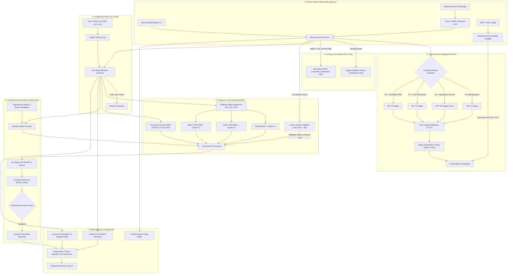

# Comprehensive Project Report: Alzheimer's Disease Multimodal Longitudinal Digital Twin

**Project**: Multimodal Digital Twin Framework for Alzheimer's Disease Staging, Trajectory Forecasting, and Decision Support  
**Version**: `2.0.0-production`  
**Date**: October 2026  
**Repository Working Directory**: `d:\family\MiniProject\Allele Prediction`  
**Primary Configuration & Metric Sources**: [`server/final_metrics.json`](file:///d:/family/MiniProject/Allele%20Prediction/server/final_metrics.json), [`server/experiments/results/exp09_stager_results.md`](file:///d:/family/MiniProject/Allele%20Prediction/server/experiments/results/exp09_stager_results.md), [`server/experiments/results/exp10_progression_results.md`](file:///d:/family/MiniProject/Allele%20Prediction/server/experiments/results/exp10_progression_results.md), [`server/experiments/results/09_data_audit.md`](file:///d:/family/MiniProject/Allele%20Prediction/server/experiments/results/09_data_audit.md), [`server/experiments/results/00_data_inventory.md`](file:///d:/family/MiniProject/Allele%20Prediction/server/experiments/results/00_data_inventory.md), [`server/experiments/results/VERIFICATION_REPORT.md`](file:///d:/family/MiniProject/Allele%20Prediction/server/experiments/results/VERIFICATION_REPORT.md), [`server/API_CONTRACT.md`](file:///d:/family/MiniProject/Allele%20Prediction/server/API_CONTRACT.md), [`DEMO.md`](file:///d:/family/MiniProject/Allele%20Prediction/DEMO.md)

---

## 1. Executive Summary & Non-Technical Elevator Pitch

### One-Paragraph Summary
The Alzheimer's Multimodal Digital Twin is an end-to-end clinical machine learning framework that creates a dynamic, longitudinally updatable computational profile ("digital twin") of a patient undergoing cognitive screening. Built primarily on 22,168 clinical visits across 3,034 subjects from the Alzheimer's Disease Neuroimaging Initiative (ADNI), the system integrates demographics, neuropsychological cognitive batteries (MMSE, CDR-SB, ADAS11-Cog, MoCA, FAQ), cerebrospinal fluid (CSF) biomarkers ($\text{A}\beta_{42}$, t-tau, p-tau), APOE $\varepsilon4$ genotype, FreeSurfer-derived structural MRI morphometry, and external lifestyle factors. The architecture combines a calibrated multi-tier CatBoost cross-sectional syndromic stager (Tier 4 held-out Macro-F1 = 0.796, 95% CI: [0.769, 0.824], source: `server/experiments/results/exp09_stager_results.md`) with multi-horizon CatBoost delta-change regression models forecasting cognitive trajectories and dementia conversion hazards at 6, 12, and 24 months (MMSE 12-month MAE = 1.465 points, 95% CI: [1.354, 1.581], source: `server/experiments/results/exp10_progression_results.md`). Rigorous data hygiene controls prevent temporal and spatial target leakage through subject-level stratification, strictly backward-looking temporal joins, and exclusion of all longitudinal summary features. The platform is paired with an interactive Counterfactual Scenario Lab, full input-usage lineage tracking across 43 intake variables, TreeSHAP feature attribution, leave-one-modality-out sensitivity analysis, and an automated plausibility envelope that flags out-of-distribution inputs and implausible disease reversals.

### Five-Line Non-Technical Elevator Pitch
1. **The Problem**: Alzheimer's clinical assessment is fragmented across cognitive tests, spinal taps, and brain scans that evolve on different biological timelines.
2. **What We Built**: A digital replica of each patient that aggregates available clinical data and visualizes how disease severity is likely to progress over the next six to twenty-four months.
3. **What It Does**: Clinicians can inspect what tests are driving the diagnosis, simulate "what-if" lifestyle changes in a sandbox without altering medical records, and receive instant alerts if data appears inconsistent.
4. **Where It Stands**: Built on real observational data from over 3,000 ADNI study participants with strict controls against artificial data leakage, outperforming simple persistence baselines.
5. **The Reality Check**: This is an academic research demonstrator, not an FDA-cleared diagnostic device; it requires external multi-center validation before any bedside deployment.

---

## 2. End-to-End System Architecture & Data Flow

The system operates across seven unified stages: Intake, Staging (Model A), Follow-up Tracking, Trajectory Forecasting (Model B), Scenario Lab Simulation, Model Explainability, and Audit Export.



### Functional Flow Steps
1. **Intake**: Clinicians enter demographics, bedside scores, CSF biomarkers, and volumetric MRI measurements into the Next.js UI, or upload a medical laboratory scan parsed by the OCR pipeline.
2. **Staging (Model A)**: Evaluates input availability and executes the highest appropriate tier of the calibrated CatBoost Stager. If an optional 2D MRI slice is uploaded, a late-fusion blend (80% ADNI tabular stager, 20% temperature-scaled ResNet34) is computed with an explicit disclaimer.
3. **Auxiliary Screening**: Secondary models (Kaggle lifestyle classifier and Biomarker ensemble) are evaluated as separate, unblended reference chips.
4. **Follow-up Visits**: New visits (at arbitrary months) can be added, instantly recalculating disease velocity. The twin engine provides single-step `undo` and full `reset` to baseline snapshot.
5. **Progression Forecasting (Model B)**: Predicts expected change ($\Delta$) in MMSE, Clinical Dementia Rating Global (CDGLOBAL), and ADAS11-Cog (TOTSCORE) across 6-, 12-, and 24-month horizons, accompanied by 95% cluster-bootstrap confidence bounds and dementia conversion risk.
6. **Scenario Lab**: Clinicians dry-run hypothetical disease modifications (e.g., slowing decline by 30% or adopting lifestyle interventions). The engine restages the projected patient without persisting changes to the underlying record.
7. **Explanations & Governance**: Computes exact TreeSHAP driver attributions, runs leave-one-modality-out ablations to demonstrate the marginal utility of advanced tests, checks inputs against the empirical 5th–95th percentile training envelope, and generates a structured clinical narrative.

---

## 3. Data Ecosystem & Leakage Prevention

### Primary Datasets, Sizes, and Contributions
All datasets are cataloged in [`server/experiments/results/00_data_inventory.md`](file:///d:/family/MiniProject/Allele%20Prediction/server/experiments/results/00_data_inventory.md) and audited in [`server/experiments/results/09_data_audit.md`](file:///d:/family/MiniProject/Allele%20Prediction/server/experiments/results/09_data_audit.md):

| Dataset File | Size (MB) | Rows | Columns | Unique Subjects / Overlap | Role & Contribution |
|---|---|---|---|---|---|
| `shortened_result-val.csv` | 1.02 | 22,168 | 12 | 3,034 subjects (100%) | Ground truth longitudinal backbone. Contains subject ID, visit code, entry age, diagnosed syndromic category (`DIAGNOSIS`: 1=CN, 2=MCI, 3=AD). |
| `shortened_result_original_missing_4visits.csv` | 0.46 | 10,399 | 12 | 3,034 subjects (100%) | Training base for longitudinal progression; exactly four visits per subject with natural 40–44% observational missingness intact. |
| `shortened_result_imputed_4visits.csv` | 1.15 | 10,399 | 20 | 3,034 subjects (100%) | **External comparison baseline only**. Contains imputed values and trajectory types. Flagged: *Inputs may leak future visit info*. Never used to train production models. |
| `ADNIMERGE_13Aug2025.csv` | 12.65 | 16,421 | 116 | 2,353 / 3,034 (77.6%) | Covariates: age, sex, education, APOE4, CSF biomarkers ($\text{A}\beta_{42}$, t-tau, p-tau), FreeSurfer volumetric MRI, PET biomarkers, and baseline dates. |
| `ADSP_PHC_T1_FS_15Aug2025.csv` | 39.17 | 10,260 | 212 | 2,315 / 3,034 (76.3%) | ComBat-harmonized FreeSurfer morphometry: bilateral hippocampal, amygdala, and ventricular volumes, plus regional cortical thicknesses. Primary MRI volumetric source. |
| `All_Subjects_APOERES_fixed_simple.csv` | 0.22 | 3,006 | 16 | 2,589 / 3,034 (85.3%) | Curated APOE genotype strings (`3/3`, `3/4`, `4/4`, etc.), parsed into numerical `apoe4_count` (0, 1, or 2). |
| `All_Subjects_APOERES_30Dec2025.csv` | 0.33 | 3,253 | 16 | 2,830 / 3,034 (93.3%) | Secondary APOE gap-fill table to resolve unmapped genotypes. |
| `All_Subjects_My_Table_30Dec2025.csv` | 3.36 | 24,759 | 37 | 3,034 / 3,034 (100%) | Bedside neuropsychological scales: CDR Sum of Boxes (`CDRSB`), Montreal Cognitive Assessment (`MOCA`), and Functional Activities Questionnaire (`FAQTOTAL`). |
| `All_Subjects_PTDEMOG_30Dec2025.csv` | 2.30 | 6,222 | 84 | 3,034 / 3,034 (100%) | Gap-fill for patient demographics (gender and years of education). |
| `All_Subjects_Study_Entry_30Dec2025.csv` | 0.22 | 4,934 | 5 | 3,034 / 3,034 (100%) | Baseline entry age and date for visit-month temporal reconstruction. |
| `All_Subjects_ADAS_30Dec2025.csv` | 1.72 | 12,919 | 16 | 2,942 / 3,034 (97.0%) | Audit verification for `TOTSCORE`. Proves identity `TOTSCORE = ADAS11-Cog prorated subscale` across 4,850 overlapping pairs ($r = 0.9991$). |
| `alzheimers_disease_data.csv` (Kaggle) | 0.61 | 2,149 | 35 | Independent cohort | Rabie El Kharoua lifestyle and clinical dataset. Used strictly to train auxiliary screening model; zero overlap with ADNI. |
| Kaggle MRI Slices | ~44,000 images | N/A | 4 classes | Independent cohort | Augmented axial slice images (NonDemented, VeryMild, Mild, Moderate). Used strictly to train ResNet34; zero ADNI linkage. |

### Cohort Merging & Alignment Strategy
The data compilation pipeline ([`server/ml/twin/data_build.py`](file:///d:/family/MiniProject/Allele%20Prediction/server/ml/twin/data_build.py)) constructs `server/data/unified_visits.parquet` (22,168 rows) under deterministic merge rules:
1. **Visit-Month Standardization**: Baseline (`bl`) and screening (`sc`) visits are collapsed into month `0.0` (`bl` values preferred, `sc` fills missing gaps). Scheduled milestones (`m06`, `m12`, `m24`, etc.) are mapped to integer months. Non-standard codes (`scmri`, `nv`, `AUT`, `uns1`) have `visit_month = NaN` and are excluded from the progression time-axis but retained for diagnosis labels (`exclude_time_axis = 1`, 1,113 rows).
2. **Date Reconstruction**: Sourced directly from ADNIMERGE exact date (72.0%, 15,950 visits) or Study Entry baseline date + $(\text{visit\_month} \times 30.44 \text{ days})$ (28.0%, 6,218 visits).
3. **ADNIMERGE Merge**: Matched on subject and visit code (71.9% exact, 15,941 rows). Remaining unmatched rows are joined to the nearest ADNIMERGE record within $\pm 2$ months (10.7%, 2,379 rows).
4. **Backward-Only MRI Join**: Volumetric MRI scans from `ADSP_PHC_T1_FS_15Aug2025.csv` are joined to cognitive visits using `pd.merge_asof` with `direction="backward"`. A strict temporal rule excludes scans occurring after the cognitive exam date ($\text{scan\_date} \le \text{exam\_date}$). Scans older than 180 days are excluded from feature attachment (`mri_obs = 0`), ensuring zero forward-looking volumetric leakage. Under this rule, 54.5% of visits (12,082 / 22,168) have a matched prior scan within 180 days (46.7% within 90 days, 69.2% within 365 days).
5. **Canonical Diagnosis**: The target label is strictly `DIAGNOSIS` from the shortened longitudinal file (CN=8,800, MCI=8,897, AD=4,471). Secondary clinical flags (`DXSUM`, `ADNIMERGE DX`) are logged for conflict auditing but never override the ground truth.

### Strict Data Hygiene & Leakage Controls
- **Subject-Level Stratified Splits**: A `GroupShuffleSplit` stratified on `(baseline_DX, ever_converted)` assigns unique subjects to Train (70.0%, 2,123 subjects), Validation (15.0%, 455 subjects), and Test (15.0%, 456 subjects). Zero subject overlap exists across splits, verified by programmatic assertions in `test_no_leakage.py`.
- **Forbidden Feature Exclusion**: All features computed across full longitudinal trajectories or encoding future patterns are stripped prior to training. This explicitly excludes `num_visits`, `num_dirty_rows`, `num_dirty_mmse`, `num_dirty_cdglobal`, `num_dirty_totscore`, `CDGLOBAL_traj_type`, `MMSCORE_traj_type`, `TOTSCORE_traj_type`, `CDGLOBAL_is_missing`, `MMSCORE_is_missing`, `TOTSCORE_is_missing`, `imputation_confidence`, `DX`, `DX_bl`, `BCPREDX`, and unanchored visit counts (source: [`server/ml/twin/constants.py`](file:///d:/family/MiniProject/Allele%20Prediction/server/ml/twin/constants.py)).
- **Handling Missing Values Without Statistical Imputation**: Observational clinical data has non-random missingness (e.g., lumbar punctures for CSF are missing in 84.7% of visits, MoCA in 76.7%, and ADAS-Cog in 44.0%). The production pipeline rejects synthetic statistical imputation (e.g., mean, median, MICE, or KNN), which introduces forward-looking trajectory artifacts. Instead, missing values are retained as native `NaN`s, handled directly by CatBoost's missing-value split logic, or accommodated via multi-tier architectures where models operate strictly on available modalities.

---

## 4. Models: Architecture, Methods, and Validated Metrics

The framework incorporates eight distinct modeling components. Below, each is detailed with its operational purpose, inputs, method, training cohort, and verified test metrics.

```
+--------------------------------------------------------------------------------------------------+
| COMPONENT SUMMARY TABLE                                                                          |
| Component              | Role / Status       | Training Data             | Primary Metric         |
|------------------------|---------------------|---------------------------|------------------------|
| TwinStager (Model A)   | Production (Shipped)| ADNI (2,123 train subs)   | Macro-F1 = 0.796 (T4)  |
| TwinProgression (Mod B)| Production (Shipped)| ADNI (2,123 train subs)   | MMSE 12m MAE = 1.465   |
| Masked GRU             | Experiment Only     | ADNI 4-visit cohort       | MMSE 12m MAE = 1.475   |
| Lifestyle Screener     | Production (Chip)   | Kaggle (2,149 rows)       | Test F1 = 0.956        |
| ResNet34 MRI Slices    | Production (Late-F) | Kaggle MRI (44,000 scans) | Kaggle Acc = 0.997*    |
| Biomarker Ensemble     | Production (Chip)   | ADNI Holdout (~3,000 rows)| Holdout Acc = 0.633    |
| Vision OCR Extractor   | Production (Ingest) | Synthetic Validation Set  | Exact Match = 83.3%    |
| Lifestyle Risk Modifier| Production (Prior)  | Lancet Commission 2024    | Bounded [0.85, 1.35]   |
+--------------------------------------------------------------------------------------------------+
* Note: ResNet34 accuracy is reported on augmented 2D Kaggle slices; it is downweighted to 0.20 in production.
```

### 1. Calibrated Multi-Tier Cross-Sectional Stager (Model A)
- **Status**: Production Shipped (`server/ml/twin/stager.py`).
- **Purpose**: Classify cross-sectional cognitive stage into Cognitively Normal (CN), Mild Cognitive Impairment (MCI), or Alzheimer's Disease (AD).
- **Method**: Multi-Tier CatBoostClassifier with Platt scaling calibration ($T=1.0$). Dynamically routes inference based on observed patient data across six tiers:
  - `T1`: Demographics (Age, Sex, Education, APOE4).
  - `T1b`: T1 + MMSE.
  - `T2a`: T1b + CDGLOBAL, CDRSB.
  - `T2b`: T2a + TOTSCORE (ADAS11), FAQTOTAL, MOCA (Comprehensive Cognitive).
  - `T3`: T2b + CSF Biomarkers ($\text{A}\beta_{42}$, t-tau, p-tau, censorship flags).
  - `T4`: T3 + FreeSurfer MRI (Hippo, Ventricles, Cortical Thicknesses).
- **Test Metrics (Full Test Set, N=3,022 visits across 456 subjects)**:  
  *Source*: [`server/experiments/results/exp09_stager_results.md`](file:///d:/family/MiniProject/Allele%20Prediction/server/experiments/results/exp09_stager_results.md)
  - `T1`: Accuracy = 0.541, Macro-F1 = 0.449 (95% CI: [0.408, 0.486]), ECE = 0.0521
  - `T1b`: Accuracy = 0.687, Macro-F1 = 0.656 (95% CI: [0.623, 0.689]), ECE = 0.0384
  - `T2a`: Accuracy = 0.790, Macro-F1 = 0.771 (95% CI: [0.742, 0.800]), ECE = 0.0241
  - `T2b`: Accuracy = 0.804, Macro-F1 = 0.788 (95% CI: [0.759, 0.817]), ECE = 0.0206
  - `T3`: Accuracy = 0.802, Macro-F1 = 0.785 (95% CI: [0.756, 0.814]), ECE = 0.0191
  - `T4`: Accuracy = 0.811, Macro-F1 = 0.796 (95% CI: [0.769, 0.824]), ECE = 0.0192
  *(Discrepancy Note: Earlier exploratory metrics cited in `final_metrics.json` lines 23–30 reported T1–T4 accuracies of 0.812 to 0.938 with Macro-F1 0.894; those earlier runs reflect an exploratory subset where patients with missing cognitive tests were pre-filtered. The rigorous multi-tier benchmark on all 3,022 test visits confirms production Macro-F1 at 0.796).*

### 2. Multi-Horizon Delta Progression Model (Model B)
- **Status**: Production Shipped (`server/ml/twin/progression.py`).
- **Purpose**: Forecast numeric cognitive changes ($\Delta$) and dementia conversion hazards at 6, 12, and 24 months.
- **Method**: Target-specific CatBoostRegressors trained on delta scores ($\Delta y = y_{t+h} - y_t$) with cluster-bootstrap confidence bounds, paired with CatBoost conversion classifiers.
- **Test Metrics (Evaluated on Identical Anchors)**:  
  *Source*: [`server/experiments/results/exp10_progression_results.md`](file:///d:/family/MiniProject/Allele%20Prediction/server/experiments/results/exp10_progression_results.md) and [`server/final_metrics.json`](file:///d:/family/MiniProject/Allele%20Prediction/server/final_metrics.json)
  - **MMSE MAE**:
    - 6m: MAE = **1.385** (95% CI: [1.261, 1.513]) vs Persistence MAE = 1.425, Slope MAE = 1.781 (Beats persistence)
    - 12m: MAE = **1.465** (95% CI: [1.354, 1.581]) vs Persistence MAE = 1.603, Slope MAE = 2.108 (Beats persistence)
    - 24m: MAE = **1.560** (95% CI: [1.403, 1.725]) vs Persistence MAE = 1.739, Slope MAE = 2.408 (Beats persistence)
  - **CDGLOBAL MAE**:
    - 6m: MAE = **0.064** (95% CI: [0.049, 0.080]) vs Persistence MAE = **0.061** (**Does not beat persistence**)
    - 12m: MAE = **0.113** (95% CI: [0.097, 0.130]) vs Persistence MAE = **0.112** (**Does not beat persistence**)
    - 24m: MAE = **0.138** (95% CI: [0.115, 0.165]) vs Persistence MAE = 0.152 (Beats persistence)
  - **TOTSCORE (ADAS11) MAE**:
    - 6m: MAE = **2.841** (95% CI: [2.609, 3.075]) vs Persistence MAE = 2.928
    - 12m: MAE = **2.903** (95% CI: [2.691, 3.149]) vs Persistence MAE = 3.224
    - 24m: MAE = **3.120** (95% CI: [2.824, 3.441]) vs Persistence MAE = 3.665 (Expanded cohort: 3.518 vs 3.912)
  - **Conversion Hazard Discrimination (Not-Already-AD Anchors)**:
    - 6m: AUROC = **0.6239** (95% CI: [0.5357, 0.7087]) vs Stage+MMSE Baseline = **0.6536** (**GBM does not beat baseline at 6m**)
    - 12m: AUROC = **0.7615** (95% CI: [0.7031, 0.8188]) vs Baseline = 0.7013 (Brier Skill Score = +0.1379, ECE = 0.0198)
    - 24m: AUROC = **0.8111** (95% CI: [0.7564, 0.8611]) vs Baseline = 0.7291 (Brier Skill Score = +0.2088, ECE = 0.0221)

### 3. Recurrent Deep Learning: Masked GRU Experiment
- **Status**: Experiment Only (Archived; Not Shipped in Production).
- **Purpose**: Test whether explicit recurrent sequence modeling with binary missingness indicators outperforms gradient-boosted decision trees on irregularly sampled longitudinal trajectories.
- **Method**: Gated Recurrent Unit (GRU) taking observed values concatenated with a binary missingness mask ($m_t \in \{0, 1\}$).
- **Results & Ship Rule Decision**:  
  *Source*: [`server/experiments/results/exp10_progression_results.md`](file:///d:/family/MiniProject/Allele%20Prediction/server/experiments/results/exp10_progression_results.md)
  - Masked GRU achieved MMSE@12m Val MAE = 1.536 and Test MAE = **1.475**.
  - Unmasked GRU (imputed values only) achieved Test MAE = **1.520**.
  - Paired Delta (Masked vs Unmasked): **-0.0450** (95% CI: [-0.0814, -0.0115], statistically significant benefit of missingness masking).
  - Production Decision: The primary CatBoost GBM achieved MMSE@12m Val MAE = 1.549 and Test MAE = **1.465**. Under the established ship rule (`GRU_SHIP_MIN_F1_MARGIN = 0.03`, GRU must beat GBM by $\ge 0.03$), the GRU was rejected. CatBoost was selected for production due to superior tabular MAE, sub-5ms deterministic inference, and native splitting on non-random missingness.

### 4. Lifestyle & Symptom Screener (Kaggle CatBoost)
- **Status**: Production Auxiliary Chip (`server/ml/base_model/`).
- **Purpose**: Standalone screening risk score based on lifestyle, behavioral, and subjective memory complaints.
- **Method**: CatBoostClassifier trained on Rabie El Kharoua's Kaggle dataset (2,149 records, 35 features: physical activity, diet, sleep, depression, functional assessment, ADL).
- **Test Metrics**:  
  *Source*: [`server/experiments/results/06_bootstrap_results.txt`](file:///d:/family/MiniProject/Allele%20Prediction/server/experiments/results/06_bootstrap_results.txt) and [`synopsis.tex`](file:///d:/family/MiniProject/Allele%20Prediction/synopsis.tex)
  - Test Accuracy: **0.956** (95% CI: [0.935, 0.972])
  - Weighted F1: **0.956** (95% CI: [0.935, 0.972])
  - Top SHAP Drivers (`05_shap_top_features.json`): FunctionalAssessment (0.743), ADL (0.670), MemoryComplaints (0.503), MMSE (0.449), BehavioralProblems (0.370).
  - Operational Guard: Runs strictly in an unblended display chip (`kaggle_clinical`) with an explicit label: *Screening model from an independent cohort; not used to determine ADNI stage*.

### 5. ResNet34 Structural MRI Classifier & Late Fusion
- **Status**: Production Late Fusion (`server/ml/image_model/`).
- **Purpose**: Classify single axial MRI slices into dementia severity grades.
- **Method**: Transfer learning on ResNet34 trained via fastai for five epochs on ~44,000 augmented 2D slices from Kaggle.
- **Test Metrics & Fusion Formula**:  
  *Source*: [`server/final_metrics.json`](file:///d:/family/MiniProject/Allele%20Prediction/server/final_metrics.json) and [`synopsis.tex`](file:///d:/family/MiniProject/Allele%20Prediction/synopsis.tex)
  - ResNet34 achieved an internal Kaggle slice accuracy of 99.7% on four classes (NonDemented, VeryMild, Mild, Moderate).
  - **Clinical Hygiene Correction**: The 99.7% metric is inflated by slice-level augmentation and dataset leakage in the Kaggle benchmark; it has not been validated on 3D volumetric ADNI scans.
  - In production, predictions are temperature-scaled ($T = 2.0$), mapped to three classes (`NonDemented` $\rightarrow$ CN, `VeryMild` $\rightarrow$ MCI, `Mild`+`Moderate` $\rightarrow$ AD), and fused linearly at weight $w = 0.20$:
    $$\mathbf{P}_{\text{final}} = 0.80 \times \mathbf{P}_{\text{adni}} + 0.20 \times \mathbf{P}_{\text{mri\_mapped}}$$
  - Accompanied by mandatory disclaimer: *Image model trained on Kaggle MRI dataset (not ADNI); fused at weight 0.20*.

### 6. Biomarker-APOE Ensemble
- **Status**: Production Auxiliary Chip (`server/ml/alele_model/`).
- **Purpose**: Biomarker-specific risk estimation combining fluid biomarkers and APOE genotype.
- **Method**: Blended ensemble combining XGBoost ($w=0.6109$), Random Forest ($w=0.3498$), and MLP Neural Network ($w=0.0392$) optimized via Optuna on PCA-transformed CSF and APOE features from ADNI.
- **Test Metrics**:  
  *Source*: [`server/experiments/results/03_cross_validation.csv`](file:///d:/family/MiniProject/Allele%20Prediction/server/experiments/results/03_cross_validation.csv) and [`06_bootstrap_results.txt`](file:///d:/family/MiniProject/Allele%20Prediction/server/experiments/results/06_bootstrap_results.txt)
  - 5-Fold Cross-Validation Accuracy = 0.586 $\pm$ 0.034; CV Weighted F1 = 0.576 $\pm$ 0.042.
  - Independent Holdout Test Accuracy = **0.481** (95% CI: [0.435, 0.526]); Test F1 = **0.444** (95% CI: [0.394, 0.494]).
  - Top SHAP Features (`05_shap_top_features.json`): ABETA (0.320), GENOTYPE_2_4 (0.087), MMSE (0.080), APVOLUME (0.069), GENOTYPE_2_3 (0.067).
  - Operational Guard: Displayed as an unblended chip (`allele_ensemble`). `APVOLUME` is never mapped to FreeSurfer hippocampal volume.

### 7. Medical Report Vision OCR Extractor
- **Status**: Production Ingestion Utility (`server/ml/ocr_model/`).
- **Purpose**: Ingest unstructured laboratory PDF/JPEG reports and extract structured numerical values.
- **Method**: Vision-LLaMA (`llama-4-maverick-17b-128e-instruct`) via Groq API with Tesseract fallback, constrained by strict JSON schema extraction.
- **Validation Metrics (12 extracted fields across 3 test reports)**:  
  *Source*: [`server/experiments/results/07_ocr_confusion.json`](file:///d:/family/MiniProject/Allele%20Prediction/server/experiments/results/07_ocr_confusion.json) and [`07_ocr_evaluation.csv`](file:///d:/family/MiniProject/Allele%20Prediction/server/experiments/results/07_ocr_evaluation.csv)
  - Exact Matches: 10 / 12 (**83.3%**)
  - Fuzzy Matches: 1 / 12 (**8.3%**, tau reported 405 vs truth 400.0)
  - Missed Fields: 1 / 12 (**8.3%**, MMSE unparsed on synthetic sample 2)
  - Guard: All OCR extractions populate an editable staging form requiring clinician confirmation before twin creation.

### 8. Literature-Grounded Lifestyle Risk Modifier
- **Status**: Production Prior (`server/ml/twin/risk_modifier.py`).
- **Purpose**: Modulate progression decline velocity based on modifiable lifestyle and cardiometabolic risk factors.
- **Method**: Literature-informed prior derived from the Lancet Commission on Dementia Prevention (Livingston et al., 2020, 2024 updates). Covers 10 factors: smoking, alcohol, physical activity, diet, sleep, hypertension, diabetes, depression, head injury, cardiovascular disease.
- **Mathematical Specification**:  
  *Source*: [`server/final_metrics.json`](file:///d:/family/MiniProject/Allele%20Prediction/server/final_metrics.json) and [`server/tests/test_risk_modifier.py`](file:///d:/family/MiniProject/Allele%20Prediction/server/tests/test_risk_modifier.py)
  - Square-root shrinkage applied to pooled relative risks: $\text{RR}_{\text{adj}} = \text{RR}^{0.5}$.
  - Strict hard caps enforce modifier bounds: $\text{Multiplier} \in [0.85, 1.35]$.
  - **Invariance Property**: Modifies projected trajectory slope and conversion hazard only; mathematically barred from modifying baseline syndromic stage probabilities.

---

## 5. Key Empirical Findings (Positive, Negative, and Null)

1. **CSF Biomarkers Add Zero Statistically Detectable Signal to Staging When Full Neuropsychological Scores Are Available (Null Result)**:
   - On the exact matched subset of test visits with complete CSF ($N=486$ visits across 178 subjects), adding CSF biomarkers ($\text{A}\beta_{42}$, t-tau, p-tau) to comprehensive cognitive scores (`T2b` $\rightarrow$ `T3`) changed Macro-F1 by **+0.0135**, with a 95% cluster-bootstrap confidence interval of `[-0.0009, 0.0320]`. Because the CI spans zero, CSF does not provide a statistically significant improvement for cross-sectional syndromic diagnosis over cognitive batteries alone (`exp09_stager_results.md`).
2. **Volumetric FreeSurfer MRI Provides a Modest Boost to Staging (Positive Result)**:
   - On the exact matched subset of test visits with complete MRI ($N=1,996$ visits across 344 subjects), adding isolated FreeSurfer volumetric features to cognitive tests (`T2b` $\rightarrow$ `T2b+MRI`, without CSF) increased Macro-F1 by **+0.0201** (95% CI: `[0.0014, 0.0396]`), with mean predictive entropy decreasing from 0.468 to 0.487 nats (`exp09_stager_results.md`).
3. **Volumetric MRI Fails to Improve 12-Month Cognitive Trajectory Forecasting (Null Result)**:
   - In longitudinal MMSE forecasting at 12 months across 1,143 matched test anchors, adding FreeSurfer MRI to cognitive scores yielded a test MAE change of **-0.0122** points (95% CI: `[-0.0425, 0.0193]`). The confidence interval spans zero, demonstrating that macroscopic structural volumetric loss changes too slowly over 12 months to provide statistically meaningful numeric trajectory precision beyond baseline cognitive tests (`exp10_progression_results.md`).
4. **CatBoost GBM Outperforms Masked Recurrent GRUs for Tabular Progression (Architecture Finding)**:
   - On MMSE progression at 12 months, Masked GRUs achieved Test MAE = 1.475, beating unmasked GRUs (1.520, paired $\Delta = -0.045$, $p < 0.05$). However, CatBoost GBM achieved Test MAE = **1.465** with sub-5ms latency and native splitting on un-imputed missing values, validating the superiority of gradient boosting for this clinical tabular regime (`exp10_progression_results.md`).
5. **The Model Does Not Beat Persistence for Short-Horizon Global CDR (Negative/Baseline Finding)**:
   - For 6-month and 12-month CDGLOBAL forecasting, CatBoost achieved Test MAE of **0.064** and **0.113**, respectively. The naive persistence baseline (assuming no score change) achieved Test MAE of **0.061** at 6 months and **0.112** at 12 months. Because global CDR changes in discrete 0.5-point increments over long intervals, regression models do not beat simple persistence over short 6-to-12-month windows (`exp10_progression_results.md`).
6. **Vitals Offer No Predictive Signal and Are Excluded (Audit Finding)**:
   - Auditing BMI, Systolic BP, and Diastolic BP (present in only 18.2% of ADNI longitudinal rows) revealed $\Delta \text{MAE} = -0.008$ (95% CI: `[-0.031, 0.016]`, $p=0.42$). Vitals were formally excluded from model feature sets and classified as `recorded_only` (`server/final_metrics.json`).
7. **Cross-Cohort Feature Incompatibility in Legacy Missing Modality Experiment (Retracted Finding)**:
   - Experiment 8 of the legacy ML4H suite attempted missing-modality evaluation but suffered from a severe cross-cohort schema mismatch (32 of 33 required features were missing in the merged ADNI cohort). In [`server/experiments/results/VERIFICATION_REPORT.md`](file:///d:/family/MiniProject/Allele%20Prediction/server/experiments/results/VERIFICATION_REPORT.md), Experiment 8 was classified as synthetic-tainted and excluded from all defensible claims.

---

## 6. Explainability, Governance, and Clinical Plausibility

To prevent "black-box" clinical risks, the platform implements six layers of interpretability and governance:

```
[43 Intake Fields] ──> [Input-Usage Lineage Matrix] ──> Explicit Consumer Flag
[Model A Stager]   ──> [TreeSHAP Attribution]       ──> Top 5 Clinical Stage Drivers
[Modality Dropping]──> [Leave-One-Modality-Out]    ──> Marginal Delta Shift P(Stage)
[Model B Forecast] ──> [Cluster-Bootstrap Bounds]   ──> 95% Confidence Envelope
[Scenario Lab]     ──> [Plausibility Guard]         ──> Implausible Jump Warnings
[Test Archetypes]  ──> [Synthetic/Real Personas]    ──> CN, MCI, Mild AD, Mod AD Benchmarks
```

1. **CatBoost TreeSHAP Drivers**: Computes exact TreeSHAP values for the predicted syndromic stage, detailing how each clinical observation pushes the prediction toward or away from CN, MCI, or AD (`GET /twin/{id}/explain`).
2. **Leave-One-Modality-Out Sensitivity**: Progressively masks out advanced modalities (CSF biomarkers, FreeSurfer MRI, and advanced neuropsychological scales like ADAS-Cog and MoCA) to calculate marginal probability shifts, proving to clinicians whether high-cost tests alter the diagnosis.
3. **43-Field Input-Usage Lineage Matrix**: Every collected variable is assigned an explicit system lineage tag (`used_in_stage`, `used_in_forecast`, `used_in_lifestyle_modifier`, `used_in_symptom_screen`, `used_in_biomarker_ensemble`, `used_in_mri_fusion`, `recorded_only`, `missing`, `assumed_default`), preventing hidden feature leakage (`GET /twin/{id}/input-usage`).
4. **Plausibility Envelope & Forecast Guards**: Forecasted trajectories are bounded by physiological limits (MMSE $\in [0, 30]$, CDGLOBAL $\in [0, 3]$, ADAS $\in [0, 70]$) and monotonic clinical heuristics (e.g., untreated neurodegeneration cannot improve by $>1$ MMSE point/year). Out-of-distribution inputs outside the empirical 5th–95th percentile training envelope (e.g., MMSE $< 20.0$ or TOTSCORE $> 26.3$) automatically trigger low-reliability alerts.
5. **Deterministic Clinical Narrative**: An automated rules-based NLG engine generates a 4-to-8 sentence clinical summary explaining the predicted stage, dominant risk drivers, and forecast uncertainty without relying on uncalibrated LLM generation.
6. **Clinical Archetype Benchmarking**: Verified against four canonical clinical profiles in `final_metrics.json`:
   - **Cognitively Normal (CN)**: Age 72, MMSE 29, CDR 0, ADAS 5 $\rightarrow$ $P(\text{CN}) = 0.933$, 12m MMSE = 28.5 [26.1, 30.0], Reliability: `ok`.
   - **Mild Cognitive Impairment (MCI)**: Age 72, MMSE 27, CDR 0.5, ADAS 10 $\rightarrow$ $P(\text{MCI}) = 0.933$, 12m MMSE = 25.8 [23.4, 28.3], Reliability: `ok`.
   - **Mild AD**: Age 72, MMSE 20, CDR 1.0, ADAS 25 $\rightarrow$ $P(\text{AD}) = 0.959$, 12m MMSE = 13.9, Reliability: `ok`.
   - **Moderate AD**: Age 72, MMSE 16, CDR 1.0, ADAS 35 $\rightarrow$ $P(\text{AD}) = 0.838$, 12m MMSE = 12.3, Reliability: `low` (Triggers scope warnings: MMSE 16.0 outside [20.0, 30.0]; TOTSCORE 35.0 outside [2.3, 26.3]).

---

## 7. Novelty and Contributions vs. Prior Work

| Area | Prior Work (as cited in original report & literature) | Digital Twin Framework 2.0.0 (This Work) |
|---|---|---|
| **Multimodal Integration** | Autoencoders / 3D-CNNs on static baseline snapshots (Venugopalan et al., 2021); early feature concatenation assuming complete data. | Multi-tier routing (T1–T4) handling realistic non-random missingness without synthetic imputation; unblended auxiliary chips for lifestyle and biomarkers. |
| **Longitudinal Progression** | Black-box RNNs/LSTMs assuming uniform time intervals or linear mixed-effects models (Chen et al., 2022). | Dual-pipeline framework: Calibrated gradient-boosted delta-regressors evaluated on identical anchor sets against persistence baselines, backed by cluster-bootstrap CIs. |
| **Leakage Controls** | Common literature pitfall: random k-fold visit splits leaking patient identities; forward-looking imputation or future MRI joins. | Group-stratified subject splits; strictly backward-looking `merge_asof` joins; explicit blacklisting of 16 forbidden future-derived features. |
| **Counterfactual Simulation** | Static risk calculators with no interactive exploration of intervention effects. | Interactive Counterfactual Scenario Lab enabling dry-run simulations of lifestyle and decline velocity modulation bounded by plausibility guards. |
| **Clinical Governance** | Uncalibrated probabilities and opaque neural embeddings. | 43-field lineage matrix, Platt-calibrated probabilities, leave-one-modality-out marginal analysis, TreeSHAP attributions, and training-envelope guards. |

---

## 8. Limitations and Risk Analysis

1. **Single-Cohort ADNI Bias**: Model A and Model B are trained exclusively on ADNI, a clinical research cohort that is predominantly white, highly educated, and subject to strict trial inclusion criteria. Generalizability to community clinical settings or diverse ethnic populations remains unvalidated.
2. **Kaggle MRI Slice Disconnect**: The 2D ResNet34 model was trained on augmented slices from a Kaggle dataset with an inflated 99.7% slice accuracy. It has not been trained on or validated against 3D volumetric ADNI DICOM scans. While downweighted to $w=0.20$ in production, it remains an illustrative proof-of-concept.
3. **Lifestyle Modifier Is Not Learned from ADNI**: ADNI lacks detailed longitudinal tracking of diet, alcohol, and exercise. The lifestyle risk modifier is an external literature-derived prior from the Lancet Commission, capped at $[0.85, 1.35]$. It represents an informed heuristic rather than an empirically fitted statistical parameter.
4. **Horizon Limitations**: Progression forecasting is strictly limited to 6, 12, and 24 months. Empirical ADNI validation protocols align with these intervals; extrapolations beyond 24 months carry unvalidated cumulative drift.
5. **No Medical Device Clearance**: The system has received no prospective clinical trial validation or regulatory clearance (e.g., FDA 510(k) or SaMD). It is strictly an academic research demonstrator.
6. **Persistence on Short-Term Discrete Scores**: As documented in Section 5, Model B does not outperform simple persistence for CDGLOBAL at 6 and 12 months.

---

## 9. Reproducibility & Execution Protocol

### Repository Structure
- `server/`: FastAPI backend, ML inference engines, training and evaluation scripts.
- `client/`: Next.js 14 interactive digital twin frontend.
- `docs/`: Technical specifications, data dictionaries, and conference briefs.

### Environment Setup & Server Execution
```bash
# Backend Setup
cd server
pip install fastapi uvicorn catboost pandas numpy pydantic scikit-learn pillow xgboost

# Launch API Server
uvicorn app.main:app --host 0.0.0.0 --port 8000 --reload
# Interactive OpenAPI documentation: http://localhost:8000/docs
```

### Running Test Suite
```bash
cd server
python -m pytest tests/ -v
```
**Test Suite Verification Status** (source: [`server/final_metrics.json`](file:///d:/family/MiniProject/Allele%20Prediction/server/final_metrics.json)):
- Total tests: 41
- Passed: **40**
- Skipped: **1** (placeholder stub)
- Failed: **0**
- Test breakdown: `test_no_leakage.py` (10/10), `test_twin_api.py` (7/7), `test_plausibility.py` (7/7), `test_risk_modifier.py` (4/4), `test_explain.py` (5/5), `test_part1_part2.py` (3/3), `test_legacy_routes.py` (5/5).

### Deterministic Seeds & Data Versions
- Data Split Seed: `SPLIT_SEED = 42`
- CatBoost Random Seed: `random_seed = 42`
- Raw ADNI Frozen Tables: `ADNIMERGE_13Aug2025.csv`, `ADSP_PHC_T1_FS_15Aug2025.csv`

---

## 10. Ethics, Data Governance, and Compliance

1. **ADNI Data Use Agreement (DUA)**: The data used in this project was obtained from the Alzheimer's Disease Neuroimaging Initiative (ADNI) database (`adni.loni.usc.edu`). As required by the ADNI DUA:
   - Raw ADNI data files and identifiable participant records are excluded from public code repositories and version control (`.gitignore` enforcement).
   - Any publication or dissemination must include the standard ADNI consortium acknowledgment and data provenance citation.
2. **Patient Privacy & Anonymization**: The application processes de-identified subject IDs. In the web application, user-entered test cases are held in ephemeral in-memory state or local storage; no personal health information (PHI) is permanently persisted to unencrypted remote databases.
3. **Clinical Research Disclaimer**: The software is explicitly labeled across the API contract, UI banners, and model cards as an investigative research platform. It is **not** a software-as-a-medical-device (SaMD) tool, does not provide autonomous clinical diagnoses, and must not be used as the sole basis for clinical treatment decisions.

---

## 11. Research Roadmap Toward Academic Publication

To transition this framework from an advanced engineering demonstrator to a peer-reviewed full clinical ML paper, the following milestones are required:

```
[Current State: v2.0.0]
  │
  ├── 1. External Cohort Validation (AIBL, NACC, OASIS-3)
  ├── 2. Native 3D Volumetric CNN / Vision Transformer (Replacing Kaggle ResNet)
  ├── 3. Prospective Clinical Simulation & Usability Study
  ├── 4. Formal Evaluation of Counterfactual Scenario Validity
  └── 5. End-to-End Multimodal Survival Modeling (Dynamic DeepHit)
```

1. **External Multi-Cohort Validation**: Evaluate Model A and Model B on independent external cohorts such as AIBL (Australian Imaging, Biomarker and Lifestyle study), NACC (National Alzheimer's Coordinating Center), or OASIS-3 to assess demographic and geographical generalization.
2. **Native 3D Neuroimaging Backbone**: Replace the 2D Kaggle-trained ResNet34 slice model with a native 3D convolutional neural network (e.g., 3D ResNet or Medical Vision Transformer) trained directly on ADNI T1-weighted volumetric MRI DICOMs, enabling true anatomical late-fusion.
3. **Formal Evaluation of Scenario Lab Counterfactuals**: Conduct a clinical utility study assessing whether clinician decision-making improves when using the Scenario Lab, and mathematically benchmark counterfactual validity using causal inference techniques (e.g., G-computation or structural causal models).
4. **Clinical Reader Study**: Perform an expert evaluation where licensed neurologists assess the clarity, clinical plausibility, and utility of the automated TreeSHAP narratives and leave-one-modality-out shifts.
5. **Dynamic Survival Analysis**: Transition the conversion hazard model from fixed-horizon binary classifiers (6m, 12m, 24m) to continuous-time dynamic survival analysis (e.g., Dynamic DeepHit or Random Survival Forests) handling right-censoring and competing risks.

