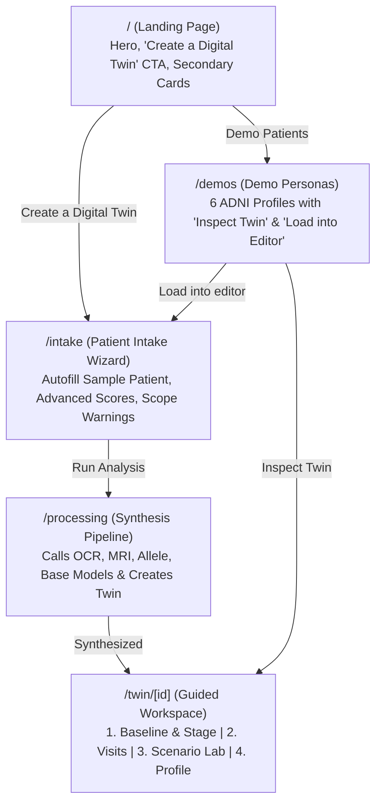

# Restructured Alzheimer's Multi-Modal Digital Twin — Frontend Walkthrough

The Alzheimer's Digital Twin platform has been restructured into a patient-specific **Digital Twin Builder** workflow, integrating the existing multi-step intake with the digital twin engine while moving demo personas to a dedicated `/demos` showcase.

---

## 1. Information Architecture & Key Routes



### Route Summary

| Route | Changes & Restructuring Implemented |
| :--- | :--- |
| **`/` (Landing)** | Kept hero styling and visual polish. Primary CTA **"Create a Digital Twin"** navigates directly to `/intake`. Secondary cards route to **"Demo Patients"** (`/demos`) and **"Temporal Prediction"**. Removed the persona grid from landing and eliminated the dev text `"GET /demo/patients (6 profiles)"` across the UI. |
| **`/demos`** | Dedicated persona grid showcasing the 6 ADNI profiles (`demo-stable-cn`, `demo-cn-mci`, `demo-mci-stable`, `demo-mci-ad-fast`, `demo-ad-sparse`, `demo-t1-only`). Each card provides **"Inspect Twin"** (`/twin/[id]`) and **"Load into editor"** (prefills `/intake` via global store). |
| **`/intake`** | Multi-step intake flow preserved and enhanced:<br>• **"Autofill sample patient"** button (74 y, Female, 16 yrs education, APOE ε3/ε4, MMSE 26, CDR 0.5, ADAS11 12, Aβ42 980, Tau 432, p-Tau181 38).<br>• Collapsible **"Advanced scores"** group: CDR-Global, ADAS11, FAQ, MoCA, p-Tau181, and Volumetric MRI (Hippocampus, Entorhinal, Ventricles, Whole Brain, ICV). Empty inputs denote `null` (unobserved/missing), never default `0`.<br>• Soft, non-blocking **Model Scope Warnings** when age (<55 or >90) or scores exceed ADNI training scope.<br>• On Run Analysis, dispatches `POST /twin` with full multimodal payload and navigates to `/processing`. |
| **`/processing`** | Automated pipeline executing OCR report parsing, MRI feature extraction, Allele risk calculation, and baseline staging before transitioning seamlessly to `/twin/[id]`. |
| **`/result`** | Redirects to `/twin/[id]` with legacy fallback compatibility. |

---

## 2. Digital Twin Workspace (`/twin/[id]`)

The workspace features a top guided stepper with 4 freely navigable steps and a persistent **Model Scope** chip:

````carousel

<!-- slide -->

<!-- slide -->

<!-- slide -->

````

### Detailed Step Features

### **Step 1: Baseline & Stage**
- **Interactive 3D Brain Visual**: Orbitable brain graphic with hoverable metric chips around the cortex (MMSE, CDR, ADAS, Aβ42, Tau, p-Tau, Hippocampus, Genotype).
- **StageCard**: Primary stage diagnosis (`CN`, `MCI`, `AD`), calibrated probability distribution summing to 1.0, data-tier badge (`T1`–`T4`), and confidence rating.
- **ModalityChips**: Present/missing badges for 5 modalities with direct add/attach dialogs.
- **"More Data Sharpens the Twin" Panel**: Guidance on advancing from current tier (e.g., T1 $\rightarrow$ T2 by adding cognitive tests, T2 $\rightarrow$ T3 by adding CSF biomarkers, T3 $\rightarrow$ T4 by adding volumetric MRI).
- **Modality Results Cards**: Legacy results carried over (primary classifier, allele risk, ResNet MRI with required `"demo-only, not validated on ADNI"` label, OCR lab panel).

### **Step 2: Follow-Up Visits**
- **Longitudinal Disease Trajectory Chart**: Dynamic Recharts curve with solid observed visit points, dashed forecast line, and purple shaded 90% bootstrap uncertainty band.
- **AddVisitPanel**: Inputs for Month, MMSE (0–30), CDR-Global (0–3), ADAS11 (0–70), with collapsible optional FAQ (0–30) and MoCA (0–30).
- **Audit Trail & TimelinePanel**: Live probability shift animations (e.g. `CN -4.0%`, `MCI +1.0%`, `AD +3.0%`) on each newly recorded visit.
- **Replay Controls**: **"Undo last visit"** (`DELETE /twin/{id}/visit/last`) and **"Reset to baseline"** (`POST /twin/{id}/reset`) allow rapid live demo resets.

### **Step 3: Scenario Lab**
- **Strict Horizon Selector**: Restricted to **6**, **12**, and **24 months ONLY**; longer horizons (36m) are disabled with a tooltip explaining that ADNI longitudinal models are calibrated up to 24m.
- **Hypothetical Visit Inputs**: Editable MMSE, CDR-Global, ADAS11, optional biomarker (Aβ42, Tau, p-Tau) and MRI volume overrides.
- **Decline Velocity Slider**: Range from `0.5x` (slower decline) to `1.5x` (rapid impairment).
- **Counterfactual Execution**: Calls `POST /twin/{id}/scenario` (dry run, saves nothing).
- **Side-by-Side Comparison**:
  - Baseline (grey) vs Scenario (colour) for stage probabilities and 12m/24m conversion risk with delta pills.
  - Dual Trajectory Chart showing baseline forecast curve (dashed grey with grey band) alongside scenario trajectory (dashed purple with purple band).
- **Action Buttons**: **"Save scenario as a real visit"** (commits to twin via `/visit`) and **"Reset to baseline"**.
- **Regulatory Disclaimers**: Verbatim notice: *"Illustrative simulation, not a clinical prediction"* and dynamic `scope_warnings`.

### **Step 4: Patient Profile**
- **One-Page Clinical Dossier**: Clean summary of patient demographics, genetic risk, multimodal ingestion status (present vs missing), diagnostic probabilities, 24-month forecast projections table, and longitudinal visit history.
- **Print / Save as PDF**: Formatted with print stylesheets (`@media print`) hiding interactive controls and rendering high-contrast clinical reports.
- **Download Twin JSON**: Downloads complete patient twin JSON snapshot.

---

## 3. Visual Proof & Screenshots

### 1. Cleaned Landing Page
*Persona grid and dev text removed; primary CTA links to `/intake`:*


### 2. Demo Personas Page (`/demos`)
*Full persona gallery with "Inspect Twin" and "Load into editor":*


### 3. Step 2 Longitudinal Visits & Replay
*Follow-up visits recorded with real-time probability shift badges and trajectory chart:*


### 4. Step 3 Scenario Lab (Side-by-Side Comparison)
*Hypothetical parameters, decline velocity slider, and dual baseline vs scenario curves:*


### 5. Step 4 Clinical Profile Dossier
*One-page report ready for print or JSON export:*


---

## 4. Full Flow Video Recording

The automated end-to-end browser execution recording:


---

## 5. Verification Checklist

- [x] Only files under `client/` edited; `server/` remained untouched.
- [x] Landing page (`/`) hero preserved, persona grid removed, dev text eliminated.
- [x] Demo personas moved to `/demos` with "Inspect Twin" and "Load into editor".
- [x] Multi-step `/intake` preserved with "Autofill sample patient" and collapsible "Advanced scores".
- [x] Soft, non-blocking scope warnings for out-of-range inputs.
- [x] `/processing` animation transitions into `/twin/[id]`.
- [x] Workspace `/twin/[id]` with 4-step guided stepper:
  - [x] Step 1 Baseline & Stage: Brain visual, hover stats, StageCard, ModalityChips, tier panel, modality cards.
  - [x] Step 2 Follow-Up Visits: AddVisitPanel (with optional FAQ/MoCA), TimelinePanel with shift animations, TrajectoryChart, "Undo last visit", and "Reset to baseline".
  - [x] Step 3 Scenario Lab: Strict 6/12/24m horizons, decline multiplier slider (0.5x–1.5x), `POST /twin/{id}/scenario` dry run, baseline (grey) vs scenario (colour) side-by-side, dual trajectory chart, "Save scenario as a real visit", and "Reset to baseline".
  - [x] Step 4 Patient Profile: One-page clinical summary, "Print / Save as PDF", and "Download twin JSON".
- [x] Persistent Model Scope chip on workspace opening `ModelCardDrawer`.
- [x] `/result` redirects to `/twin/[id]`.
- [x] ResNet MRI and multimodal fusion labeled `"demo-only, not validated on ADNI"`; 99.7% Kaggle figure omitted.
- [x] `npm run build` passes with zero TypeScript or lint errors.
